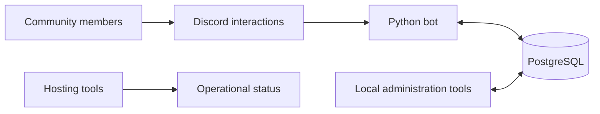

# EAFC Galaxy

**A custom Discord community bot with support workflows, moderation, and administration tools.**

EAFC Galaxy brings recurring community-management tasks into one system: helping members get support, managing applications, assigning roles, and giving administrators tools to manage the bot.

> This repository is a project showcase. The source code is private and is not distributed here.

## Project at a glance

| Area | Overview |
| --- | --- |
| Platform | Discord |
| Core technology | Python and discord.py |
| Data storage | PostgreSQL through Supabase |
| Administration | Local administration and hosting tools |
| Source availability | Private |

## Core capabilities

### Support and application workflows

- Private support and Premium ticket channels.
- Ticket claiming, assignment, participant management, and closing workflows.
- HTML transcripts and ticket reviews.
- Multi-step applications with saved progress.

### Community management

- Rules acceptance and self-service roles.
- Welcome messages and giveaways.
- Moderation tools, warnings, and appeal workflows.
- Administrator-controlled configuration.

### Administration

- Local tools for managing setup, content, and giveaways.
- Draft review before applying changes.
- Hosting tools for inspecting the bot's operational status.

## System overview

## Design decisions

- **Persistent workflows:** Database-backed state supports workflows that need to survive restarts.
- **Controlled administration:** Configuration and administrative actions are restricted to the appropriate users.
- **Member privacy:** Ticket access and internal logs are part of the permission design.
- **Editable content:** Community-facing text is separated from operational configuration.

## Project status

This showcase describes capabilities documented in the project. It is not a public bot release or a hosted demo, and it does not certify the deployment status of individual features.

Screenshots and a more detailed walkthrough will be added as this showcase develops.

## Source code

The implementation remains private. This repository presents the project's purpose, capabilities, and technical approach without publishing the application, configuration, member data, or internal administration details.
